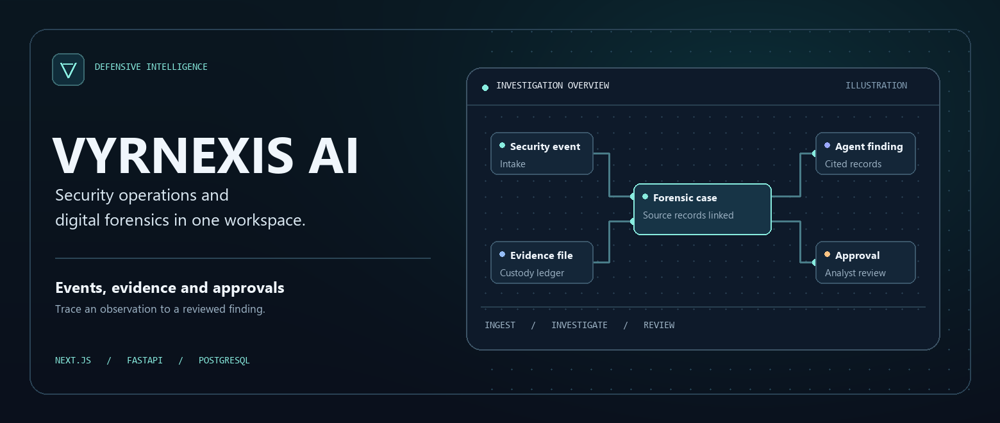

# VYRNEXIS AI

VYRNEXIS AI is a local defensive security operations and digital forensics workspace. It connects submitted activity to tenant-scoped investigations with traceable evidence and analyst decisions.

[Download the full application source](https://github.com/ArtifactShruti/vyrnexis-ai/releases/download/v0.1.0-source-preview/vyrnexis-ai-source.zip) · [Source preview and Git history bundle](https://github.com/ArtifactShruti/vyrnexis-ai/releases/tag/v0.1.0-source-preview) · [Portfolio case study](https://artifactshruti.github.io/#vyrnexis-ai)

| Workspace | Implemented capabilities |
| --- | --- |
| Command center | Date-selectable 7- and 30-day charts of recorded security events, alerts, and opened incidents. |
| Forensics | Assigned cases, evidence hashes, custody records, and report exports. |
| Investigation | Seven deterministic analyzers over tenant-owned records and a Copilot that cites stored sources. |
| Workflow and impact | Published workflow versions, persisted approval steps, and simulations over recorded dependencies. |
| Business Intelligence | Recorded payment and refund reporting by original currency. |

### Reproduce the local demo

Download the application source and follow its `DEPLOYMENT.md` guide. The `scripts/smoke_flagship.py` demonstration follows synthetic sign-ins and refunds through incident confirmation, an assigned case, evidence verification, and approvals.

### Roadmap

- Saved dashboard views and filters, authorized data exports, and case aging charts.
- Ingestion health history, schema mapping, and replay controls.
- Workflow draft autosave and clearer investigation and dependency navigation.

The current snapshot passed 58 isolated backend tests, frontend lint, TypeScript, and a production build. The dashboard API was checked on local SQLite and PostgreSQL stacks. Live provider and independent security verification remain open.
