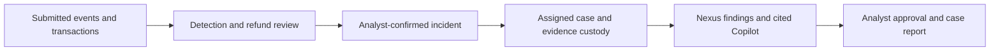

# VYRNEXIS AI


VYRNEXIS AI is a defensive security operations and digital forensics workspace. It connects submitted events and transactions to tenant-scoped investigations with traceable evidence and analyst decisions.

[Local setup](DEPLOYMENT.md) · [Architecture](docs/ARCHITECTURE.md) · [Product status](IMPLEMENTATION_STATUS.md) · [Roadmap](docs/ROADMAP.md)

| Workspace | What it does |
| --- | --- |
| Command center | Shows API-backed incident, investigation, and graph metrics alongside a selectable 7-day or 30-day activity chart. |
| Security operations | Evaluates submitted authentication observations, stores findings and source events, and lets analysts confirm an alert into an incident. |
| Digital forensics | Assigns cases, records versioned notes and evidence custody, verifies file hashes, and exports case reports. |
| Investigation Nexus and Copilot | Runs seven deterministic analyzers and retrieves cited records. Optional provider inference requires explicit configuration and authorization. |
| Workflow Studio and Digital Twin | Executes versioned workflows with persisted approval steps and simulates impact on recorded dependencies. |
| Fraud and business analytics | Correlates synthetic refund fixtures with recorded signals and reports observed commerce totals by original currency. |

## See the workflow

This diagram shows the investigation path exercised by the synthetic PostgreSQL demonstration.



Run `python scripts/smoke_flagship.py` against the isolated PostgreSQL Docker stack to reproduce the scenario. It creates clearly labeled synthetic records through the application APIs. [Verification guide](docs/TESTING.md)

The application is a locally verified engineering project. Signed-in visual acceptance across roles and viewports, live model verification, and an independent security review remain open. [Security status](SECURITY.md)

## Local development

Install dependencies from the repository root:

```powershell
python -m venv .venv
.venv\Scripts\python -m pip install -r apps/api/requirements.txt
npm install
```

Set a persistent local signing key in the current PowerShell session, then start the API and frontend in separate terminals:

```powershell
$env:JWT_SECRET = python -c "import secrets; print(secrets.token_urlsafe(48))"
$env:VYRNEXIS_API_PORT = '8001'
python -m uvicorn app.main:app --app-dir apps/api --reload --port 8001
```

```powershell
$env:VYRNEXIS_API_URL = 'http://127.0.0.1:8001'
npm.cmd run dev --workspace apps/web -- --hostname 127.0.0.1
```

Open `http://127.0.0.1:3000`. Register an organization or sign in. The frontend keeps access and refresh tokens in `HttpOnly`, `SameSite=Strict` cookies; client JavaScript cannot read them.

API documentation: `http://127.0.0.1:8001/docs`.

Endpoint summary: [docs/API_DOCUMENTATION.md](docs/API_DOCUMENTATION.md). Verification instructions: [docs/TESTING.md](docs/TESTING.md).

## Docker Desktop

The Compose stack runs the API on `http://127.0.0.1:8001` and the web app on `http://127.0.0.1:3000`. Keep a random local `JWT_SECRET` in the ignored `.env` file so sessions retain the same signing key across restarts. If that file does not exist, run this once from the repository root:

```powershell
if (-not (Test-Path -LiteralPath '.env')) {
    $localSigningKey = python -c "import secrets; print(secrets.token_urlsafe(48))"
    Set-Content -LiteralPath '.env' -Value "JWT_SECRET=$localSigningKey"
}
```

Seed the isolated demo database before the first start. Start or rebuild with `docker compose up -d --build`. Check service status with `docker compose ps`.

Compose deliberately mounts only `.dev-logs/vyrnexis-demo.db` and `.dev-logs/evidence`. It never mounts or seeds the existing `vyrnexis.db`. The demonstration deployment is a local validation environment, not production configuration.

### Isolated PostgreSQL and Redis stack

From the repository root:

```powershell
./scripts/start-postgres.ps1
docker compose --env-file .env.postgres -f docker-compose.postgres.yml ps
```

Open [the PostgreSQL demo app](http://localhost:3001) and register a local synthetic organization. Use that hostname for the PostgreSQL frontend and `127.0.0.1:3000` for the SQLite frontend so the browser keeps their session cookies separate. The PostgreSQL API is at `http://127.0.0.1:8002/docs`. Compose applies Alembic migrations before starting the API and worker. PostgreSQL, Redis, and evidence have their own named volumes. PostgreSQL and Redis are accessible only on the Compose network.

The SQLite seed adds two authentication detection rules and five synthetic sign-ins. Open Security Operations to inspect the repeated-failure and unfamiliar-device alerts. Confirm an alert to create an incident with its source events and graph links.

### Batch ingestion and refund investigation

Open **Data sources** from the command center. Create a source for security, commerce, or assets and upload version 1 JSON or CSV. The workspace shows accepted, duplicate, and rejected rows. You can retry the same file with the same key. Submit corrected rows as a new batch.

The SQLite seed includes a synthetic commerce source with three refunds linked by recorded account and device labels to the authentication scenario. Open **Fraud intelligence**, inspect the highest scoring finding, and confirm it if you want to create a training incident. The report shows the applied factors, underlying observations, evidence, and alternative explanations. You can open the incident and its graph directly from the report.

### Forensic cases and Investigation Nexus

Open [Forensic cases](http://localhost:3001/platform/forensics) to create and assign a case, attach records, revise notes, and generate versioned PDF or JSON reports. Upload original bytes in [Evidence Vault](http://localhost:3001/platform/evidence-vault), then copy the file ID into the case's registration form. Once registered, the case records custody actions and authorized exports.

Open **Image metadata** in either evidence inspector to see supported JPEG and standard TIFF fields. Use **Verify stored bytes** in the vault for older files. If a file has custody history, record a **verify** action in its case. Successful verification can add the metadata to the original file record. Capture time is shown as embedded, with its time zone unverified.

Open [Investigation Nexus](http://localhost:3001/platform/nexus) from a case or the command center. Choose a tenant case or incident, queue the seven local analyzers, inspect their findings and evidence references, and approve or reject the run. PostgreSQL runs jobs through the worker. SQLite runs the same persisted pipeline inline and includes a synthetic training case after the demo owner is seeded.

The PostgreSQL worker stops each task process after 30 seconds by default. Set `VYRNEXIS_INVESTIGATION_TASK_TIMEOUT_SECONDS` to an integer from 3 to 40 when starting the stack to change the deadline.

### AI provider settings, knowledge, and Copilot

Open [AI settings](http://localhost:3001/platform/ai-settings) as an organization admin to select a provider, model, spending limit, and context policy. The stacks start in deterministic mode. The API reads optional operator configuration from ignored `.env.ai`. The worker and web containers receive no provider keys.

Set `VYRNEXIS_AI_ENABLE_EXTERNAL=1` only for authorized external requests. Define the operator's `VYRNEXIS_AI_OPENAI_KEY`, `VYRNEXIS_AI_ANTHROPIC_KEY`, or `VYRNEXIS_AI_GEMINI_KEY`. A provider's optional `_URL` is its HTTPS API base. Each external provider needs its `_INPUT_MICROS_PER_1K` and `_OUTPUT_MICROS_PER_1K` rates in USD micros, for the configured model including any separately charged token types. Model usage applies the saved tenant daily ceiling and a bounded request rate. Verify rates with the provider before enabling spending.

For local Ollama, set `VYRNEXIS_AI_ENABLE_LOCAL=1` and `VYRNEXIS_AI_OLLAMA_URL` to an operator-controlled local service with cloud functionality disabled. Install a model through an authorized operator workflow. The connection test checks saved model availability without sending tenant context.

In [Knowledge base](http://localhost:3001/platform/knowledge), index an authorized document up to 2 MiB. Choose private or organization visibility, then search by keyword. In [Copilot](http://localhost:3001/platform/copilot), create a conversation, optionally select an incident or case, and ask a question. Record search returns actual excerpts with citations. Each model-assisted request requires confirmation of what will be sent.

When hybrid mode is authorized and enabled, select a completed Nexus task and open **Model interpretations**. The model receives the saved finding summary and source identifiers. Its output and review stay separate from the deterministic result. For finished runs with failed or timed-out tasks, forensic writers can replay the original plan or a selected task with its prerequisites.

In Fraud Intelligence, select a finding and open **Counterfactual scenarios**. Change a device link, refund assumption, disputed event, or correlation thresholds to compare the saved result, current baseline, and hypothetical result. Scenarios are stored separately from findings and evidence.

### Workflow Studio, Digital Twin, and Business Intelligence

From the command center, open [Workflow Studio](http://localhost:3001/platform/workflows), [Digital Twin](http://localhost:3001/platform/digital-twin), or [Business Intelligence](http://localhost:3001/platform/analytics). Start with a workflow template and run a dry run before publishing. In Digital Twin, record a dependency with source rationale, select a target, and save an outage or isolation comparison. Business Intelligence totals recorded activity within a selected range and original currency and exports the selected period.

Copilot can stream text from configured providers. The final answer and citations become available after validation. For local hybrid search, the operator can configure an approved Ollama embedding model and then index a synthetic document through the Knowledge Base. Setup and local release checks are documented in [DEPLOYMENT.md](DEPLOYMENT.md) and [docs/TESTING.md](docs/TESTING.md).

## Isolated synthetic demonstration

This demonstration uses `.dev-logs/vyrnexis-demo.db` and does not modify the existing `vyrnexis.db` database. From the repository root:

```powershell
$env:PYTHONPATH = 'apps/api'
$env:DATABASE_URL = 'sqlite:///./.dev-logs/vyrnexis-demo.db'
python scripts/seed_demo.py
python scripts/seed_demo.py --create-demo-user
```

The second command prompts for a password without echoing it and stores only an Argon2id hash. Sign in as `demo.admin@vyrnexis-demo.org` using the password entered at the prompt. Start the API in this same configured environment, and point the frontend at port 8001 as shown above. Demo entities and incidents are synthetic and must not be interpreted as live organizational intelligence.

## Security status

Domain API routes require a signed access token and enforce tenant membership. Access tokens expire after 15 minutes; refresh tokens are rotated and sessions can be revoked. Roles limit write actions on supported domains. This is an incremental security baseline, not a production-readiness or compliance claim. Configure `JWT_SECRET` from a secrets manager in production, enforce HTTPS for secure cookies, and add MFA, rate limiting, account recovery, and a migration framework before production deployment. The development signing key fallback is ephemeral; sessions will not survive an API restart unless `JWT_SECRET` is explicitly configured.

## Project status

See [IMPLEMENTATION_STATUS.md](IMPLEMENTATION_STATUS.md), [DEVELOPMENT_LOG.md](DEVELOPMENT_LOG.md), [NEXT_TASKS.md](NEXT_TASKS.md), and [AI governance](docs/AI_GOVERNANCE.md).
